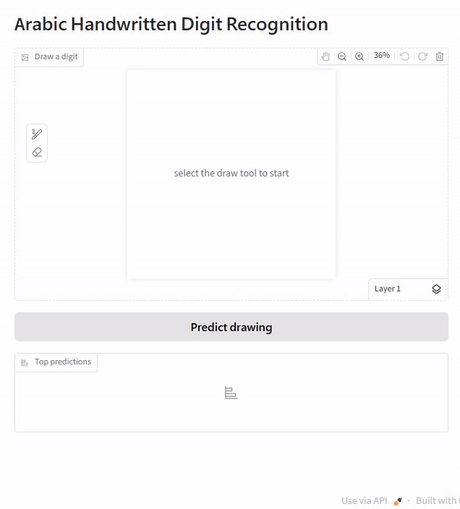
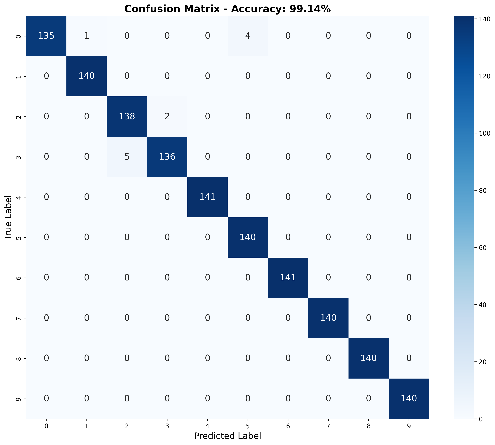
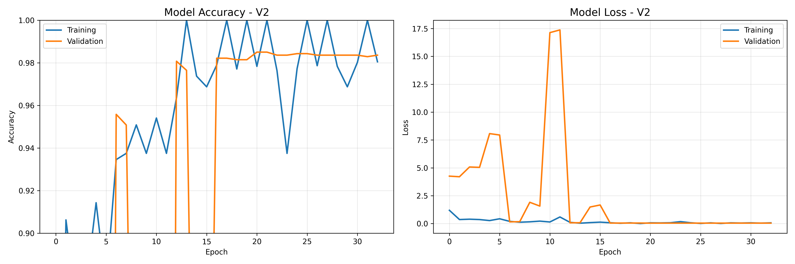

# Arabic Handwritten Digit Recognition

TensorFlow CNN for classifying handwritten Arabic numerals (0-9).



## Dataset

Uses the [Mendeley Handwritten Arabic Numerals (0-9) dataset](https://data.mendeley.com/datasets/5hpkf8v7bg/1) by Huzain Azis and Intan Novita Saly (CC BY-NC 3.0): 9,350 images resized to 64×64 pixels. The documented split is 6,544 training, 1,403 validation, and 1,403 test images.

The dataset directory should contain one folder per digit:

```text
data/
├── 0/
├── 1/
├── ...
└── 9/
```

## Setup

Use Python 3.11 or 3.12.

```bash
pip install -r requirements.txt
```

## Usage

Train and save the best model to `models_optimized_v2/best_model.keras`:

```bash
python train.py --data-dir data
```

Evaluate the saved model on the test split:

```bash
python evaluate.py --data-dir data --model-path models_optimized_v2/best_model.keras
```

Predict a digit from an image:

```bash
python predict.py path/to/digit.png --model-path models_optimized_v2/best_model.keras
```

Launch the drawing and upload demo:

```bash
python app.py --model-path models_optimized_v2/best_model.keras
```

The same `app.py` runs on Hugging Face Spaces. Set `MODEL_PATH` in the Space settings if the model is not at the default path.

The trained model is not included in the repository. Training and evaluation save plots and metrics in `results_optimized_v2/`.

## Results

The project report records 99.14% test accuracy on 1,403 images.

| Confusion matrix | Training history |
|---|---|
|  |  |

## Project report

See [final_vision.pdf](final_vision.pdf) for methodology and results.
